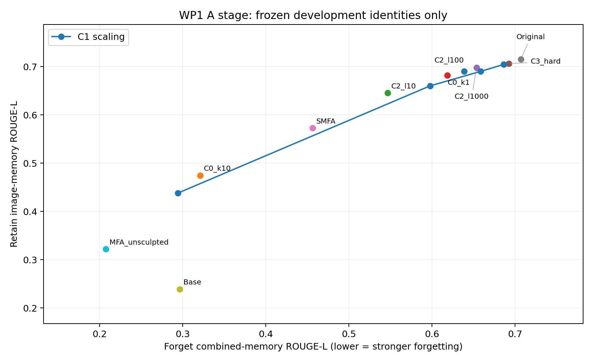

# WP1 A 阶段实验记录与结果

完成时间（UTC）：2026-10-23T16:19:21.508686+00:00

10 个新增候选均已完成开发评测，共 23,750 条回答；975 条同期事实性评分完成。按冻结规则选 λ_rel=10，B 阶段开发余量为 2.0 个百分点。当前 α=1 的 C2 遗忘弱于 SMFA，尚不能据此认定工作点1成功；后续需要补强度点并在确认组检验。

规则和抽样冻结时间（UTC）：2026-10-23T10:42:01.654667+00:00。冻结记录见 [开工前冻结记录.md](开工前冻结记录.md)，文件哈希见 [FREEZE.sha256](FREEZE.sha256)。该清单自身 SHA256：`d51326251f857a5322fdacb82465c9b8a6ba802e88e368fb28b8f0f2b8bb8710`。

本阶段仅 F1 25 人和开发保留 100 人，每候选 2,375 题（475 遗忘 + 1,900 保留）；未生成 F2 或测试保留集的新候选结果。原始、基座、SMFA 和不雕刻 MFA 参照直接抽取自第0步回答。

| 冻结项目 | 规则 |
|---|---|
| 合并记忆非劣效 | 中心90%区间上界 <5个百分点 |
| 单通道护栏 | 图像、文本记忆各自中心90%区间上界 ≤10个百分点 |
| 文本监控 | 匹配目标处，归一化文本记忆 ROUGE 残余比 SMFA 高 >5个百分点时补强度或另选点 |
| 软硬算子接近 | 保留图像记忆 ROUGE 绝对差 <0.01 时选软收缩；等于0.01选较高者 |
| 停止扩参 | 匹配目标且通过文本监控后，C4a/C4/C5相对最佳C0/C1/S0的提升均≤0.01 |
| 四项v3新增 | 同意同期评分、文本监控、A后一次性决定余量、第二折独立选择及补跑 |
| 主终点 | 确认保留集图像记忆事实性相对SMFA的配对95%区间下界 >0 |
| 次终点 | 保留文本/人脸理解/有意义性点估计下降≤0.2并报告区间；眼科拒答下降须事实性不降；遗忘眼科仅报告 |
| 两折 | 当前完成第一折A；第二折仍须独立执行选择规则 |

阈值0.01按ROUGE本身解释，不换算成固定的事实性分差。停止规则是开发决策，不是统计学支配证明。

B1 固定种子 20261023，原始 1,100 条按比例最大余数分层抽 128 条，覆盖 44 人：

| 样本类型 | 原始条数 | 抽中条数 |
|---|---:|---:|
| multimodal | 550 | 64 |
| ophthalmic | 50 | 6 |
| pure_text | 500 | 58 |

B2 固定8项构图/头部几何模板，外观留出固定6项成像/覆盖文字/图像质量模板，见 [templates.json](templates.json)。v3所举发色、眼镜、衣物、表情、背景等示例与评测任务重叠，故在看候选前替换。与评测图像理解题的最大内容词 Jaccard=0.25（剔除阈值≥0.5）；另存最近题与语义复核。B2与留出题的任务不重叠，留出题只诊断与Original的一致性及拒答，可能存在类别变化少的问题。

C1构造核对已通过：168个语言模型q/k/v/o/gate/up模块与保存的未雕刻MFA逐元素一致；106个down/视觉模块与保存的SMFA逐元素一致。MFA_multi保留FP32，MFA_text/RA先FP16再FP32；更新和加法FP32，最终权重FP16。每个候选从Original重新构造。

C0两点为k_multi/k_text=1/2、10/20，所有模块雕刻；已有SMFA为5/10。C1的c=1仍保留down/视觉掩码，因此不等于第0步未雕刻MFA。C2三个λ与C3均固定α=1，只修正两套MFA的A因子。

A 阶段 λ 选择：10。固定规则为：比较同一合并遗忘记忆 ROUGE 处，C2 相对 C1 插值曲线的保留图像记忆提升。

| 配置 | 遗忘合并记忆 ROUGE | 遗忘图像 | 遗忘文本 | 保留图像 | 保留文本 | 保留眼科宽松拒答 |
|---|---:|---:|---:|---:|---:|---:|
| C0_k1 | 0.63875 | 0.60790 | 0.67474 | 0.69027 | 0.76111 | 1.0% |
| C0_k10 | 0.32116 | 0.25713 | 0.39587 | 0.47457 | 0.68169 | 14.0% |
| C1_c0p25 | 0.68639 | 0.63604 | 0.74513 | 0.70442 | 0.76314 | 0.0% |
| C1_c0p5 | 0.65874 | 0.60541 | 0.72095 | 0.69004 | 0.76315 | 0.0% |
| C1_c0p75 | 0.59784 | 0.56026 | 0.64168 | 0.65997 | 0.74256 | 3.0% |
| C1_c1p0 | 0.29437 | 0.23611 | 0.36235 | 0.43792 | 0.66531 | 14.0% |
| C2_l10 | 0.54670 | 0.50549 | 0.59479 | 0.64518 | 0.73645 | 3.0% |
| C2_l100 | 0.61862 | 0.58424 | 0.65873 | 0.68154 | 0.75531 | 1.0% |
| C2_l1000 | 0.65373 | 0.62522 | 0.68699 | 0.69760 | 0.76617 | 0.0% |
| C3_hard | 0.69252 | 0.65810 | 0.73268 | 0.70609 | 0.76166 | 0.0% |
| SMFA | 0.45650 | 0.40464 | 0.51701 | 0.57266 | 0.70700 | 9.0% |
| Original | 0.70711 | 0.67559 | 0.74388 | 0.71550 | 0.75809 | 0.0% |
| Base | 0.29664 | 0.23150 | 0.37264 | 0.23890 | 0.39955 | 0.0% |
| MFA_unsculpted | 0.20771 | 0.16323 | 0.25961 | 0.32185 | 0.63025 | 15.0% |

| λ | 同遗忘水平的 C1 保留图像 ROUGE | C2 提升 |
|---|---:|---:|
| 10 | 0.622557 | +0.022625 |
| 100 | 0.670236 | +0.011308 |
| 1000 | 0.687570 | +0.010030 |

| C0/C3 | 相对同遗忘水平 C1 的保留图像 ROUGE 差 |
|---|---:|
| C0_k1 | +0.010092 |
| SMFA | +0.016111 |
| C0_k10 | +0.017045 |
| C3_hard | 超出范围，不外推 |

SMFA与两个C0点均在已测C1插值曲线上方约0.0101–0.0170，说明开发集上掩码相对整体缩放有收益。三个C2点也在曲线上方，其中λ=10提升最大；这是相对实测四点的线性插值比较，未测中间强度的曲线形状仍有不确定性。C3遗忘合并ROUGE=0.69252，略超C1已测上限0.68639，故不能判定它相对C1更好或更差，也不能据此完成软硬算子选择。

各候选完整的集合×题型×图像类型ROUGE、精确/宽松拒答率、回答词数/字符数（新生成另有token数）保存在对应metrics.json；以下额外列出保留眼科与文本监控。

| 配置 | 保留集平均回答词数 | 保留眼科理解 ROUGE | 遗忘文本残余相对SMFA（百分点） |
|---|---:|---:|---:|
| C0_k1 | 10.48 | 0.87794 | 42.489 |
| C0_k10 | 9.94 | 0.78057 | -32.629 |
| C1_c0p25 | 10.36 | 0.89878 | 61.449 |
| C1_c0p5 | 10.41 | 0.89665 | 54.937 |
| C1_c0p75 | 10.26 | 0.87810 | 33.584 |
| C1_c1p0 | 9.96 | 0.76471 | -41.660 |
| C2_l10 | 10.16 | 0.87743 | 20.952 |
| C2_l100 | 10.38 | 0.87741 | 38.177 |
| C2_l1000 | 10.32 | 0.89706 | 45.788 |
| C3_hard | 10.36 | 0.89712 | 58.095 |
| SMFA | 10.05 | 0.80979 | 0.000 |
| Original | 10.49 | 0.90075 | 参照 |
| Base | 25.31 | 0.03886 | 参照 |
| MFA_unsculpted | 9.89 | 0.74086 | 参照 |

此处文本监控是各观测点的诊断，不代表已匹配遗忘水平；B阶段插值到目标后仍须单独检查 +5 点阈值。

S0 共84组，方向数 r 范围 14–1147，均值 330.89；视觉能量占比范围 98.02%–99.61%，组均值 99.29%。逐层84组记录见 [S0_summary.json](statistics/S0_summary.json)。

| 输入组 | 组数 | r范围 | 平均r | 视觉能量占比范围 |
|---|---:|---:|---:|---:|
| attn | 28 | 39–351 | 187.14 | 99.18%–99.58% |
| o | 28 | 14–495 | 239.82 | 98.21%–99.61% |
| mlp | 28 | 15–1147 | 565.71 | 98.02%–99.39% |

算子单元检查全部通过：r=0和λ=0逐元素不变，硬投影清除受保护方向、正交补不变，大λ趋近硬投影，固定模块和有限值通过。全量真实特征系统另核对84组、336个MFA A因子；最大相对特征残差2.18e-6，硬投影残差7.99e-7。

975条事实性评分完成：SMFA, C0_k10, C2_l10 各325条，同期交错提交。评分模型qwen-plus，提示和模型参数沿用第0步；API模型名、返回ID、时间、原始响应及分数均本地保存。

| 相对同期 SMFA | 记忆类型 | 差值（百分点） | 90%区间 | h |
|---|---|---:|---|---:|
| C0_k10 | image_memory | -23.545 | [-29.271, -18.137] | 5.567 |
| C0_k10 | text_memory | -16.977 | [-22.584, -11.547] | 5.518 |
| C0_k10 | combined_memory | -20.166 | [-24.520, -16.029] | 4.245 |
| C2_l10 | image_memory | 15.925 | [9.132, 23.298] | 7.083 |
| C2_l10 | text_memory | 11.156 | [6.667, 15.927] | 4.630 |
| C2_l10 | combined_memory | 13.472 | [9.286, 17.889] | 4.302 |

规划取较宽的合并 h=4.302 点，仍高于原定精度2.5点。按冻结公式 m=min(5,ceil(2·max(0,h−2.5))/2)，B阶段余量定为 2.0 点，目标合并记忆 ROUGE=0.448290（SMFA为0.456500）；δ 保持5点，单项上限10点，默认两折。余量只是 ROUGE 上的开发启发式，不保证事实性非劣效通过。

C2 λ=10、α=1 的合并事实性残余比SMFA高 13.472 点，其90%区间上界超过5；同时观测点文本ROUGE残余高20.952点。这个点用于选择λ和估算区间，不能直接作为通过遗忘判定的最终配置。

SMFA 同回答重打分漂移：平均差 -0.0308，平均绝对差 0.0492 分，逐题分数完全一致 96.6%，人物配对95%区间 [-0.0677, 0.0000]。区间接近零的浮点尾数按零展示；一次重复无法区分评分随机性和服务端漂移。

人物配对bootstrap为20,000次、种子20261023，每次四模型联合抽人并重算分母，不平均逐人比值、不截断。A阶段的 Base/Original 分母来自历史评分，仅用于规划；确认时仍需同期重打。这里的区间不覆盖选择流程的不确定性，不据此声称测试成功。

每候选配置、构造时间、生成时间和逐人缓存在 candidates/；统计试跑成本见 [cost_estimate.json](pilot/cost_estimate.json)；原始模型、基座、SMFA参照由第0步按固定划分抽取。

后续 B1：选定 λ 的软收缩与硬投影分别补 α=1.5、2、3，按本次冻结的目标和0.01规则选算子。A阶段收尾后尚未启动B阶段。

| 配置 | 构造耗时（秒） | 生成及汇总耗时（秒） |
|---|---:|---:|
| C0_k1 | 244.2 | 3673.5 |
| C0_k10 | 240.6 | 3899.7 |
| C1_c0p25 | 131.9 | 3666.8 |
| C1_c0p5 | 121.5 | 3675.2 |
| C1_c0p75 | 124.0 | 3621.0 |
| C1_c1p0 | 126.2 | 3550.6 |
| C2_l10 | 136.5 | 3603.8 |
| C2_l100 | 131.1 | 3590.3 |
| C2_l1000 | 134.1 | 3652.4 |
| C3_hard | 131.8 | 3610.1 |

同期975条事实性评分执行耗时：700.3 秒。全量B1成功采集及检查点耗时 1300.2 秒，特征分解及保存耗时 78.0 秒；此前失败重跑额外耗时见 implementation_events.json 和日志。

统计数值核对：前缀相对差最大 0.1821%，重复视觉探针相对差最大 0.5676%。S0与S0d使用同一张图的首次激活，前者乘精确出现次数，后者计一次，遵循v3 §3.6。

实现修复及偏差记录：最初文件名遮蔽Python标准库导致导入失败，改名后启动；图像/纯文本的公共前缀为2 token，额外空白计入文本；FP16序列长度数值差异经完整激活诊断后改用相对范数检查。失败的未完成统计不进入最终候选。

2层10条试跑先于正式统计，包含人脸、眼科及纯文本。试跑最大GPU已分配显存 16.02 GiB，单矩阵 49.00 MiB；层数线性上界预计全量采集 5157.5 秒、特征分解 36.7 秒。成功全量实际峰值 16.02 GiB，CPU矩阵 12.06 GiB；实际总耗时与预计差异已以上列数字报告。试跑逐条序列长度、token划分及前向耗时见 pilot/S0_summary.json。

前缀仅存2 token的激活及128次计数；不同的空白token并入文本。每组视觉token去重267,754、重复488,884，文本3,852。矩阵累加器在CPU，乘法和特征分解在GPU以FP32执行，TF32关闭；这降低GPU显存占用，不改变统计定义。

收尾审计通过（UTC 2026-10-23T16:25:43.731943+00:00）：10个候选各2,375条、共23,750条均与冻结开发人物和源题目逐条核对；975个分数的输入哈希、回答/标准答案元组及范围检查通过；冻结文件和候选代码哈希未变。见 [completion_audit.json](completion_audit.json)。

| 同期事实性平均分 | 图像记忆 | 文本记忆 | 合并记忆（7:6） |
|---|---:|---:|---:|
| SMFA | 3.9086 | 5.9800 | 4.8646 |
| C0_k10 | 2.3371 | 4.5800 | 3.3723 |
| C2_l10 | 4.9714 | 6.9000 | 5.8615 |
