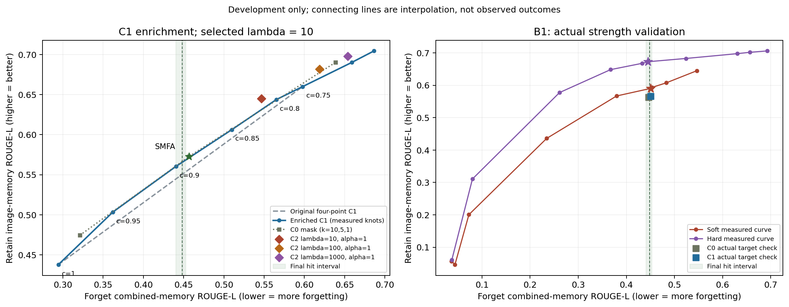

# A 补点与 B1：实验记录及结果

完成报告生成时间（UTC）：2026-10-24T15:32:06.294347+00:00

补充冻结时间：2026-10-24T00:55:31.187982+00:00。最早新回答时间：2026-10-24T01:01:17.204697+00:00。冻结顺序检查通过。
冻结清单 SHA-256：`f5cfac05b778e2538b6abeef47dc725b0a19c87b8393fe9f17ea6c49b1d3a272`。原 A 阶段全部冻结文件和 21 项结果哈希核验通过。

## 规则与范围

- 目标合并记忆 ROUGE：0.4482903966；实测命中范围 [0.44029, 0.45229]。
- 沿用 m=2.0、δ=5、单通道上限10个百分点、文本监控+5个百分点、软硬差小于0.01选软收缩。
- 候选仅用 F1 25 人和开发保留100人，每配置2,375题；无 F2/测试保留集候选生成，无 API 打分。
- 新 λ 在任何 B1 新 α 生成前单独锁定。诊断结果不参与选参。
- 保留冻结的十层诊断切片；在采集前另存确定性的十八层扩展记录，完整诊断覆盖全部28层、84组。
- 不进入 B2 或第二折。另利用等待 C1 最后一个点的空档，做固定分半的 B1 文本稳定性诊断，不参与选参。

## C1 补点与 λ 重选

| c | 遗忘合并记忆 ROUGE | 保留图像记忆 ROUGE | 保留眼科拒答率 | 保留回答词数 |
|---:|---:|---:|---:|---:|
| 0.25 | 0.686389 | 0.704423 | 0.00% | 10.36 |
| 0.5 | 0.658740 | 0.690043 | 0.00% | 10.41 |
| 0.75 | 0.597839 | 0.659973 | 3.00% | 10.26 |
| 0.8 | 0.565095 | 0.643759 | 7.00% | 10.19 |
| 0.85 | 0.509828 | 0.606247 | 7.00% | 10.16 |
| 0.9 | 0.440623 | 0.560557 | 10.00% | 10.05 |
| 0.95 | 0.362049 | 0.503483 | 13.00% | 9.96 |
| 1 | 0.294374 | 0.437921 | 14.00% | 9.96 |

原四点 λ=10；八点重选 λ=10；必要夹点后的最终重选 λ=10。

图中散点为实测配置，连线仅为插值；阴影表示冻结的最终命中范围。

| λ_rel | C2 遗忘合并 ROUGE | C2 保留图像 ROUGE | 新 C1 插值参照 | 超出参照 |
|---:|---:|---:|---:|---:|
| 10 | 0.546704 | 0.645182 | 0.631276 | 0.013906 |
| 100 | 0.618624 | 0.681544 | 0.670236 | 0.011308 |
| 1000 | 0.653731 | 0.697600 | 0.687570 | 0.010030 |

### 人物 bootstrap

独立重抽遗忘与保留人物，同一人群内各模型共用抽样；20,000次、种子20261023，每次重新插值，无外推。
**以下区间不含曲率误差和完整选择流程的不确定性，也不是事实性分的区间。**

| 配置 | 相对 C1 的保留图像 ROUGE 差 | 条件95%区间 | 有效重抽次数 |
|---|---:|---|---:|
| SMFA | 0.001623 | [-0.008671, 0.012575] | 20000 |
| C0_k1 | 0.010092 | [0.000460, 0.020636] | 20000 |
| C0_k10 | 0.010695 | [-0.002908, 0.024561] | 20000 |
| C2_l10 | 0.013906 | [0.002852, 0.025830] | 20000 |
| C2_l100 | 0.011308 | [0.002930, 0.020793] | 20000 |
| C2_l1000 | 0.010030 | [0.000818, 0.020533] | 20000 |

## 外观留出题灵敏度

正对照为未雕刻 MFA 相对 Original：拒答净增幅<2个百分点，且全部150题的平均ROUGE-L一致度≥0.90，判为不灵敏。SMFA作为辅助对比。Original拒答子集和非拒答子集另存。

| 模板组 | 对比模型 | 一致度 ROUGE-L | 拒答增幅（百分点） | 判不灵敏 |
|---|---|---:|---:|---|
| appearance_holdout | SMFA | 0.652435 | 7.333 | False |
| appearance_holdout | MFA_unsculpted | 0.513026 | 27.333 | False |

最终模板字段：`appearance_holdout`；最终正对照仍不灵敏：False。
若主模板不灵敏，按预定规则整套切换一次，原结果保留并写协议修订；不按单题表现换题，不再搜索第三套模板。若备用也不灵敏，后续外观诊断接近零不能作为同图感知恢复无效的证据。

## 激活与 LoRA 诊断

Original 仅做提示前向，不放入参考答案；视觉按图去重，文本分带图/纯文本，并单列合并文本，公共前缀不计入诊断矩阵。S0、S0d、S1 的基底来自原 B1 统计。

| 数据集 | token | S0平均覆盖 | S0d平均覆盖 | S1平均覆盖 |
|---|---|---:|---:|---:|
| D_fm | V_unique | 0.852596 | 0.861305 | 0.859700 |
| D_fm | T_image | 0.564271 | 0.615704 | 0.855058 |
| D_fm | T_pure | 0.501820 | 0.550363 | 0.782712 |
| D_fm | T_all | 0.534487 | 0.584429 | 0.819710 |
| D_rh | V_unique | 0.870794 | 0.877433 | 0.874906 |
| D_rh | T_image | 0.564008 | 0.615638 | 0.859029 |
| D_rh | T_pure | 0.502701 | 0.551635 | 0.784244 |
| D_rh | T_all | 0.532598 | 0.582773 | 0.820082 |
| D_fi | V_unique | 0.878222 | 0.884014 | 0.881358 |
| D_fi | T_image | 0.594997 | 0.640209 | 0.818800 |
| D_fi | T_pure | — | — | — |
| D_fi | T_all | 0.594997 | 0.640209 | 0.818800 |

上表为84组等权平均；逐组方向数、覆盖率、文本分型和原始迹均见 `diagnostics/coverage.json`。零token项为缺失，不填0。

| 数据集 | token | C2 λ10响应 | C2 λ100响应 | C2 λ1000响应 | C3硬投影响应 |
|---|---|---:|---:|---:|---:|
| D_fm | V_unique | 0.531582 | 0.424217 | 0.326976 | 0.285232 |
| D_fm | T_image | 0.606628 | 0.502332 | 0.398597 | 0.349561 |
| D_fm | T_pure | 0.650379 | 0.560196 | 0.461937 | 0.413667 |
| D_fm | T_all | 0.626720 | 0.529188 | 0.428298 | 0.379788 |
| D_rh | V_unique | 0.519555 | 0.409010 | 0.311156 | 0.269978 |
| D_rh | T_image | 0.606368 | 0.502223 | 0.398347 | 0.349752 |
| D_rh | T_pure | 0.648534 | 0.557594 | 0.458940 | 0.410381 |
| D_rh | T_all | 0.627294 | 0.529961 | 0.428980 | 0.380541 |
| D_fi | V_unique | 0.513829 | 0.401578 | 0.304450 | 0.263782 |
| D_fi | T_image | 0.592956 | 0.489179 | 0.387489 | 0.340047 |
| D_fi | T_pure | — | — | — | — |
| D_fi | T_all | 0.592956 | 0.489179 | 0.387489 | 0.340047 |

响应按所有六类模块累加能量后开方，不是响应比的算术平均；α=1，针对LoRA更新，不包括基座相加后的fp16舍入。分层/模块结果保存在 `response_ratios.json`。

| e_i/e_1 阈值（严格大于） | 全谱方向数：最小/中位/最大 | 90%保护子空间内：最小/中位/最大 |
|---:|---|---|
| 0.1 | 1/2/6 | 1/2/6 |
| 0.01 | 3/24/59 | 3/24/59 |
| 0.001 | 38/177.5/396 | 14/169/396 |

## B1 强度网格、命中与算子选择

| 配置 | 遗忘合并 ROUGE | 遗忘图像 ROUGE | 遗忘文本 ROUGE | 保留图像 ROUGE | 保留文本 ROUGE |
|---|---:|---:|---:|---:|---:|
| C0_target0 | 0.446165 | 0.390443 | 0.511175 | 0.563266 | 0.703370 |
| C1_c0p8 | 0.565095 | 0.517155 | 0.621026 | 0.643759 | 0.738628 |
| C1_c0p85 | 0.509828 | 0.451785 | 0.577544 | 0.606247 | 0.726937 |
| C1_c0p9 | 0.440623 | 0.368239 | 0.525070 | 0.560557 | 0.708367 |
| C1_c0p95 | 0.362049 | 0.291873 | 0.443921 | 0.503483 | 0.689029 |
| C1_target0 | 0.450686 | 0.386928 | 0.525070 | 0.566020 | 0.710298 |
| C2_a1p25 | 0.234423 | 0.224285 | 0.246251 | 0.436032 | 0.650406 |
| C2_a1p5 | 0.072821 | 0.091791 | 0.050689 | 0.200616 | 0.510452 |
| C2_a2p0 | 0.036776 | 0.039512 | 0.033584 | 0.056953 | 0.192726 |
| C2_a3p0 | 0.043806 | 0.055790 | 0.029824 | 0.046207 | 0.030241 |
| C2_bracket1 | 0.379693 | 0.333075 | 0.434081 | 0.567047 | 0.700138 |
| C2_bracket2 | 0.482973 | 0.441307 | 0.531583 | 0.607669 | 0.713157 |
| C2_target0 | 0.453118 | 0.411555 | 0.501607 | 0.593367 | 0.710504 |
| C2_target1 | 0.450633 | 0.411555 | 0.496223 | 0.590437 | 0.710555 |
| C3_a1p5 | 0.656560 | 0.636304 | 0.680191 | 0.701921 | 0.764581 |
| C3_a2p0 | 0.630531 | 0.617640 | 0.645570 | 0.697717 | 0.761574 |
| C3_a3p0 | 0.523749 | 0.546375 | 0.497352 | 0.682887 | 0.720015 |
| C3_a5 | 0.080154 | 0.114095 | 0.040557 | 0.310658 | 0.450801 |
| C3_a8 | 0.037246 | 0.045794 | 0.027274 | 0.060352 | 0.070988 |
| C3_bracket1 | 0.261123 | 0.373294 | 0.130257 | 0.577554 | 0.595083 |
| C3_bracket2 | 0.367170 | 0.458171 | 0.261003 | 0.648385 | 0.666044 |
| C3_target0 | 0.432789 | 0.500294 | 0.354033 | 0.667865 | 0.695907 |
| C3_target1 | 0.444592 | 0.508883 | 0.369586 | 0.672734 | 0.698787 |

| 族 | 实测状态 | 最终配置 | 遗忘合并 ROUGE | 文本监控差（百分点） | 实测保留图像 ROUGE | 固定目标处插值保留 ROUGE |
|---|---|---|---:|---:|---:|---:|
| C0 | matched | C0_target0 | 0.446165 | -1.570 | 0.563266 | 0.565199 |
| C1 | matched | C1_target0 | 0.450686 | 2.173 | 0.566020 | 0.564720 |
| C2 | matched | C2_target1 | 0.450633 | -5.598 | 0.590437 | 0.589665 |
| C3 | matched | C3_target1 | 0.444592 | -39.710 | 0.672734 | 0.673208 |

算子选择状态：`selected`；选中 `C3`；软减硬的保留图像ROUGE差为 -0.083543。
只在实际命中且通过文本监控的算子之间，按§6.2比较固定目标处的插值保留指标；差的绝对值<0.01时选软收缩。若硬投影到α=8仍无可行匹配，结论仅限τ=0.9和实测强度范围。
两个实际命中点的保留差另报为 -0.082297，不替代同目标比较。最初代码曾按实际点直接比较，已在任何新C2/C3生成前登记实现修正，见operator_comparison_correction.json及OPERATOR_COMPARISON.sha256；原冻结文件未覆盖。
**这是开发集上的ROUGE选择，不构成测试集非劣效或事实性优越的结论。**

## 耗时与验收

| 配置 | GPU | 构造秒 | 本次生成墙钟秒 | 逐题生成累计秒 |
|---|---:|---:|---:|---:|
| C0_target0 | 0 | 240.9 | 3592.9 | 3591.6 |
| C1_c0p8 | 0 | 133.1 | 3646.8 | 3645.6 |
| C1_c0p85 | 1 | 138.3 | 4083.7 | 4082.3 |
| C1_c0p9 | 0 | 136.6 | 3580.2 | 3578.6 |
| C1_c0p95 | 1 | 135.7 | 3841.2 | 3839.9 |
| C1_target0 | 1 | 150.4 | 3597.2 | 3595.9 |
| C2_a1p25 | 0 | 133.3 | 1276.9 | 3512.3 |
| C2_a1p5 | 1 | 135.3 | 1269.5 | 3432.3 |
| C2_a2p0 | 1 | 134.3 | 3382.8 | 3381.6 |
| C2_a3p0 | 0 | 131.5 | 3457.2 | 3456.1 |
| C2_bracket1 | 0 | 131.2 | 3577.6 | 3576.5 |
| C2_bracket2 | 0 | 115.7 | 3599.6 | 3598.4 |
| C2_target0 | 0 | 117.8 | 3590.1 | 3588.9 |
| C2_target1 | 0 | 120.2 | 3590.2 | 3588.8 |
| C3_a1p5 | 1 | 132.4 | 3595.1 | 3593.9 |
| C3_a2p0 | 0 | 138.1 | 3641.3 | 3640.0 |
| C3_a3p0 | 1 | 116.6 | 3584.6 | 3583.6 |
| C3_a5 | 1 | 132.9 | 3403.4 | 3402.3 |
| C3_a8 | 1 | 130.5 | 3407.4 | 3406.3 |
| C3_bracket1 | 1 | 128.0 | 3452.9 | 3451.7 |
| C3_bracket2 | 1 | 135.1 | 3520.1 | 3518.8 |
| C3_target0 | 1 | 135.3 | 3549.0 | 3547.9 |
| C3_target1 | 0 | 142.4 | 3604.9 | 3603.4 |

如有恢复，“本次墙钟”只覆盖最后一次运行；逐题累计秒包含保留缓存中每道题的实际生成时间。

GPU 1 在诊断采集期间提前并发运行一个评测进程；显存预算经试跑核对，推理与构造设置不变。重叠起止时间见 `gpu1_concurrency.json`，墙钟耗时包含资源共享的影响。

- 新候选 23 个，合计 54625 道开发题。
- 冻结时间、代码/配置身份、逐题人物与题目、开发边界、B1前λ锁定及最终命中均经程序审计。
- 所有原始输出和大统计留在本地，本报告和审计仅汇总实验结果。
- 详细文件索引见 README.md；结果哈希清单为 RESULTS_supplement.sha256。

### 诊断采集耗时与资源

| 阶段 | 提示条数 | 层数 | 采集秒（含检查点） | 峰值分配显存 GiB | 前缀最大相对变化 | 视觉重复探针最大相对变化 |
|---|---:|---:|---:|---:|---:|---:|
| pilot | 10 | 2 | 20.9 | 16.02 | 0.001521 | 0.000000 |
| D_fm | 325 | 28 | 2333.8 | 16.02 | 0.001521 | 0.000000 |
| D_rh | 300 | 28 | 2965.2 | 16.02 | 0.001572 | 0.000000 |
| D_fi | 125 | 28 | 1275.2 | 16.02 | 0.000000 | 0.000000 |

显存为诊断进程的峰值分配量；不包括并行评测进程。采集计时含定期检查点，最终逐组矩阵落盘可能略晚。

### B1 文本分半稳定性（可选诊断）

固定种子20261023，按样本类型将128条B1校准样本分成64+64条；沿用含参考答案的原校准输入。两半分别构造文本及一次公共前缀的二阶矩，比较其90%能量子空间。

| 指标 | 84组最小值 | 中位数 | 最大值 |
|---|---:|---:|---:|
| A子空间覆盖B | 0.604948 | 0.777397 | 0.902228 |
| B子空间覆盖A | 0.615149 | 0.778434 | 0.903067 |
| 重叠 / 较小方向数 | 0.474526 | 0.576461 | 0.979779 |
| 重叠 / 较大方向数 | 0.462289 | 0.566716 | 0.979779 |

这里只评估S1文本分量，样本分半可能共享人物，不是人物留出或总体置信区间，也不替代完整S1稳定性评估。逐组方向数见 `stability/results.json`。
