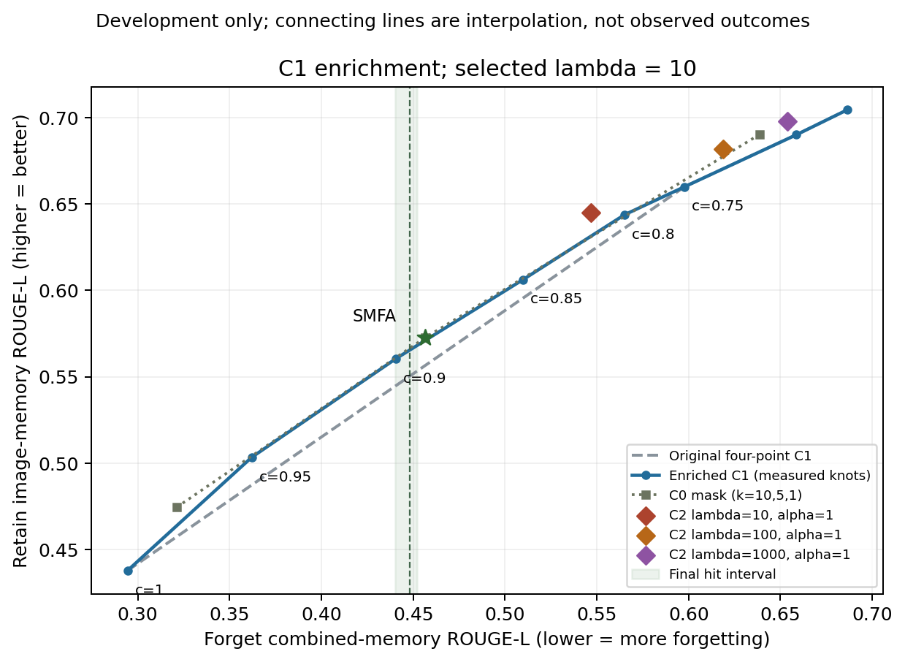

# C1补点与λ重选结果

记录生成时间（UTC）：2026-10-24T03:58:47.391174+00:00

任务2已完成，B1已启动但尚未完成。本记录不包含B1最终算子结论。

λ重选为 **10**；原四点结果同为λ=10。新λ于2026-10-24T03:55:20.216325+00:00锁定，早于B1新生成。

## 补点

| c | 遗忘合并记忆ROUGE | 保留图像记忆ROUGE | 保留眼科宽松拒答率 | 保留平均回答词数 |
|---:|---:|---:|---:|---:|
| 0.25 | 0.686389 | 0.704423 | 0.00% | 10.362 |
| 0.5 | 0.658740 | 0.690043 | 0.00% | 10.412 |
| 0.75 | 0.597839 | 0.659973 | 3.00% | 10.256 |
| 0.8 | 0.565095 | 0.643759 | 7.00% | 10.195 |
| 0.85 | 0.509828 | 0.606247 | 7.00% | 10.156 |
| 0.9 | 0.440623 | 0.560557 | 10.00% | 10.054 |
| 0.95 | 0.362049 | 0.503483 | 13.00% | 9.958 |
| 1 | 0.294374 | 0.437921 | 14.00% | 9.959 |

目标0.4482903966由c=0.85和0.9夹住，遗忘合并ROUGE间距0.06920497≤0.1，因此未触发额外夹点。八点选择与最终选择相同。

## λ选择：原§6.1

| λ | 原四点C1参照下优势 | 八点C1参照下优势 | 条件95%人物bootstrap区间 |
|---:|---:|---:|---|
| 10 | 0.022625 | 0.013906 | [0.002852, 0.025830] |
| 100 | 0.011308 | 0.011308 | [0.002930, 0.020793] |
| 1000 | 0.010030 | 0.010030 | [0.000818, 0.020533] |

λ10仍是预定点估计规则的胜者，但与λ100只差0.00260。重抽样中三个λ排名第一的频率分别为51.92%、27.98%、20.10%；这是固定配置下的排名波动，不是总体最优概率。

## SMFA、C0相对新C1

| 配置 | 相同遗忘ROUGE下保留图像ROUGE差 | 条件95%区间 |
|---|---:|---|
| SMFA | 0.001623 | [-0.008671, 0.012575] |
| C0_k1 | 0.010092 | [0.000460, 0.020636] |
| C0_k10 | 0.010695 | [-0.002908, 0.024561] |

方法：人物为单位，遗忘25人和保留100人独立重抽，同一队列各模型用相同抽样，每次重新插值。20,000次，种子20261023。全部比较的20,000次均有实测点夹住，无外推。

**区间不含曲率误差、完整选择流程的不确定性或事实性评分不确定性。** SMFA相对新C1的区间跨0，因此当前结果不支持在该遗忘水平断言SMFA掩码优于缩放。C2的正优势是开发集条件结果，且α=1处遗忘弱于目标，需要B1匹配后再比较。

## B1已提交的实测基线

| 基线 | 插值确定参数 | 目标 | 实测状态 |
|---|---|---:|---|
| C0 | k_multi=5.3032940816, k_text=10.6065881632 | 0.4482903966 | 正在生成，最终状态见matching/ |
| C1 | c=0.8944600325 | 0.4482903966 | 正在生成，最终状态见matching/ |

两项都将检查实测命中范围[0.44029,0.45229]和文本残余监控，不把插值预测当作实测成功。

## 新点耗时

| c | 构造秒 | 生成秒 |
|---:|---:|---:|
| 0.8 | 133.1 | 3646.8 |
| 0.85 | 138.3 | 4083.7 |
| 0.9 | 136.6 | 3580.2 |
| 0.95 | 135.7 | 3841.2 |

c=0.85及0.95的部分生成与GPU1诊断共享资源，计时需结合gpu1_concurrency.json。所有新候选只评测F1+开发保留集，每配置2375题；未调用评分API。
